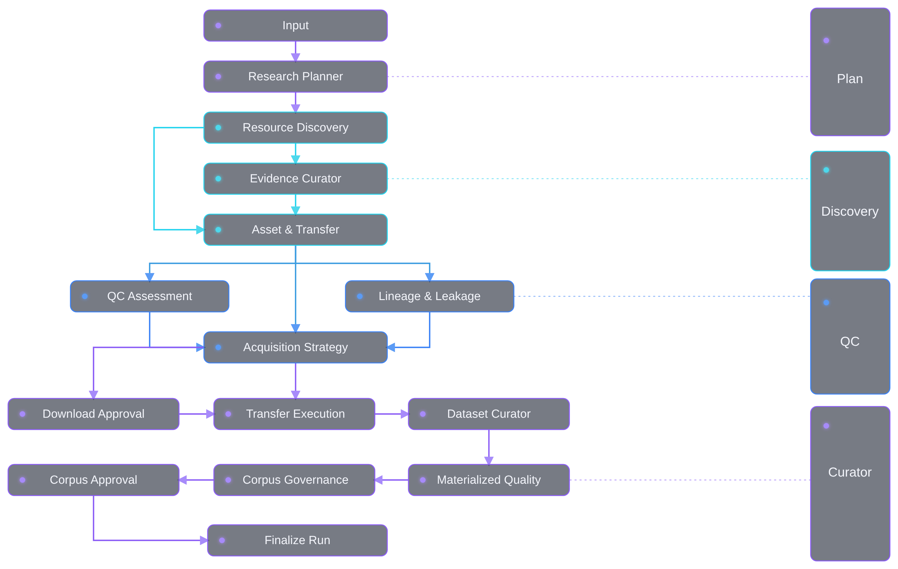

<p align="center">
  
</p>

<p align="center">
  <a href="https://github.com/yuanfu-bio/CellLore/actions/workflows/tests.yml"></a>
  
  
  
</p>

<p align="center">
  <strong>Evidence-first discovery and curation for public single-cell epigenomics data.</strong>
</p>

<p align="center">
  CellLore turns a biological question into a traceable data-acquisition plan,<br />
  verifies study and file evidence, pauses for approval, and builds an auditable local corpus.
</p>

## Overview

Finding a public dataset is easy; deciding whether it is scientifically usable is not.
A promising accession may describe the wrong organism, combine separate assays, omit
the files needed for analysis, expose only an unopened archive, or provide evidence
too weak to support a same-cell claim.

CellLore treats those uncertainties as first-class data. It combines public archive
metadata, publication evidence, file inventories and post-transfer checks in one
approval-gated workflow. Every recommendation retains the evidence behind it, and
anything unresolved is sent to review instead of being silently guessed.

The 1.0 archive is a scoped research release for public human
same-cell/same-nucleus RNA–ATAC discovery and curation, with GEO as the primary study
source. It is complete within that declared scope.

### What CellLore delivers

| Stage | Result |
|---|---|
| Research planning | A typed requirement and executable source-query plan |
| Discovery | Candidate studies with organism, assay and publication evidence |
| Pairing | Traceable PairUnits and an explicit physical-pairing evidence level |
| Inventory | Files, URLs, roles, sizes, checksums and availability states |
| Preflight | Deterministic access, modality, pairing, licence and completeness gates |
| Acquisition | Recommended, manual-review and excluded Bundle tiers |
| Materialization | Preserved source assets, manifests, provenance and curated directories |
| Quality control | Compression, HDF5, genome, barcode, fragment and matrix checks |
| Governance | Immutable corpus snapshots behind a second human approval |
| Review | React control room, SQLite audit ledger and downloadable catalog |

CellLore prepares evidence and data for downstream analysis. It does not replace
Scanpy, Seurat, Signac, ArchR or assay-processing pipelines.

## Workflow

<p align="center">
  
</p>

The LangGraph supervisor coordinates planning, discovery, evidence review, remote
inventory, preflight, transfer, materialization, QC, lineage and governance. Two
persisted checkpoints keep consequential actions under human control:

1. **Download approval** — retain the plan, approve all recommended Bundles, or
   approve a selected subset.
2. **Corpus approval** — publish or reject the governed Corpus Snapshot after local
   validation.

No data bytes are transferred before the first checkpoint is resolved.

## Quick start

### Requirements

- Python 3.12
- Mamba or Conda
- A configured model provider for real curation runs

The production web interface is already bundled in the Python package. Node.js is
needed only when modifying the frontend.

### Install

```bash
git clone https://github.com/yuanfu-bio/CellLore.git
cd CellLore

mamba env create -f environment.yml
mamba activate celllore
python -m pip install -e .
```

### Configure the model

```bash
cp .env.example .env
$EDITOR .env
celllore llm-check
```

Configure exactly one provider in `.env`. The file is ignored by Git and must never
be committed. `llm-check` validates configuration without sending a billable
request.

For sustained NCBI use, set both metadata-discovery and transfer contact variables:

```bash
export NCBI_EMAIL='you@example.org'
export NCBI_CONTACT_EMAIL='you@example.org'
```

### Start the control room

```bash
celllore serve --database var/celllore.sqlite --port 8000
```

Open <http://127.0.0.1:8000> and submit a question such as:

> Find public human PBMC datasets with RNA and ATAC measured in the same cell or nucleus.

The control room shows live workflow state, evidence artifacts, model usage, approval
requests and the resulting curation catalog.

### Run from the CLI

```bash
celllore agent-run \
  'find public human PBMC datasets with same-cell RNA and ATAC measurements' \
  --database var/celllore.sqlite \
  --data-root data \
  --remote-probe
```

When the run pauses, inspect the open checkpoint in the UI or persisted graph state,
then resume it:

```bash
celllore graph-state RUN_ID --database var/celllore.sqlite

celllore resume CHECKPOINT_ID \
  --option recommended \
  --database var/celllore.sqlite
```

Use `--option plan_only` to save the curation plan without transferring data.
`--bundle-id` can be repeated to approve only selected recommended Bundles.

Real curation runs require LLM reasoning. `--no-llm` exists for deterministic tests
and offline debugging; it must not be used to produce corpus-admission decisions.

See [docs/commands.md](docs/commands.md) for manifest workflows, licence modes,
checkpoint options, evaluation, frontend development and release verification.

## Outputs

### Curator catalog

The web interface exposes four searchable operational tables. The XLSX export includes
the same tables plus the active policy:

| Sheet | Contents |
|---|---|
| `01_Studies` | Study evidence, catalog status and next action |
| `02_Pair_units` | Same-cell/same-nucleus logical units and pairing evidence |
| `03_Files` | File roles, URLs, sizes, checksums and audit states |
| `04_Audit_Hold` | Review reason, procedure, pass criteria and release condition |
| `05_Policy` | Hard requirements from the selected CurationProfile |

A discovered study is never dropped merely because its PairUnit or manifest remains
unresolved; it is retained as an actionable hold.

### Persistent records

- **SQLite run ledger** — tasks, messages, artifacts, checkpoints and model calls.
- **Append-only Catalog** — evidence claims, assets, Bundle states, QC, lineage and
  corpus snapshots.
- **XLSX export** — a portable curator review artifact.
- **Production tree** — source-preserving, inspection-friendly directories beneath
  `data/production/`.

A typical materialized PairUnit has this shape:

```text
data/production/<date>_RUN_<run_id>/<study>/<pair_unit>/
├── 01_metadata/
├── 02_rna_raw_counts/
├── 03_atac_fragments/
├── 04_standardized/
│   ├── rna/
│   ├── atac/
│   ├── metadata/
│   ├── pairing/
│   └── qc/
├── 05_auxiliary/
└── 99_raw_optional/
```

## Evidence and safety guarantees

The project is built around enforceable invariants:

- **No bytes before consent.** Transfer is unreachable before persisted approval.
- **No access circumvention.** Paywalled and controlled-access data remain
  metadata-only.
- **Evidence strength is explicit.** Repository statements, article statements,
  model inference, file observation and recomputation are distinct evidence classes.
- **Local claims require local bytes.** `FILE_OBSERVED` and `RECOMPUTED` cannot be
  emitted before transfer.
- **Unknown is not absent.** Unopened archives and unfamiliar layouts remain explicit
  review states.
- **Hard gates are deterministic.** Models plan, interpret and summarize; code decides
  whether required evidence and validators pass.
- **Pairing means physical pairing.** Same-donor or same-sample assays never satisfy a
  same-cell requirement.
- **Evaluation families stay out of training.** Lineage membership propagates across
  identifiers, URLs and checksums.

## Source coverage

| Source | Role | Coverage |
|---|---|---|
| NCBI GEO | Primary studies, samples and supplementary files | Direct |
| NCBI SRA | Linked sequencing records | Direct |
| ENA | FASTQ manifests, checksums and byte sizes | Direct |
| Europe PMC | Publication metadata and open full text | Direct |
| Zenodo / Figshare | Author-deposited files linked from evidence | Linked resolution |
| EGA / dbGaP | Controlled-access visibility | Metadata-only |

A source without an implemented adapter is recorded in
`QueryPlan.uncovered_sources`; it is never represented as searched.

## Architecture

```text
interfaces  ──► application ──► domain
                    │
                    └─────────► infrastructure ──► domain
```

| Layer | Path | Responsibility |
|---|---|---|
| Domain | `src/celllore/domain` | Typed contracts, evidence rules, lifecycle and gates |
| Application | `src/celllore/application` | Agents, orchestration, catalogs and workflows |
| Infrastructure | `src/celllore/infrastructure` | Public APIs, models, persistence, transfer and QC |
| Interfaces | `src/celllore/interfaces` | Typer CLI, FastAPI API and packaged UI |
| Frontend | `frontend` | React/Vite control room source |

`tests/test_architecture.py` enforces the dependency direction. The canonical runtime
graph is `application.orchestration_v2`; older serialized enum values remain readable
only for persisted-run compatibility.

## Reproducibility

The default test suite is offline: public API responses and network behavior are
replayed or mocked, so CI requires no model key.

```bash
python -m pip install -e '.[dev,curation]'
ruff check src tests scripts
pytest

python scripts/eval_discovery.py --out var/scorecard.json
python scripts/compare_scorecards.py \
  eval/baseline_scorecard.json var/scorecard.json
```

The evaluation harness replays captured repository records through requirement
compilation, candidate merging and feasibility decisions. CI also builds the React
bundle, checks that packaged assets are current, scans for committed credentials, and
validates the Python wheel and source distribution.

## Scope boundaries

CellLore 1.0 intentionally does not claim:

- private or controlled-data acquisition;
- paywall or authentication bypass;
- arbitrary atlas ingestion;
- automatic inspection of archive members before transfer;
- universal file-role inference;
- arbitrary matrix-to-AnnData/MuData conversion;
- FASTQ-to-matrix processing.

These are release boundaries, not hidden successes. When evidence or file structure
falls outside the supported contract, CellLore records the limitation and routes the
Bundle to review.

## Project documentation

- [Reusable commands](docs/commands.md)
- [Maintainer knowledge](docs/journal.md)
- [Contribution guide](CONTRIBUTING.md)
- [Configuration template](.env.example)

## Support

For a reproducible issue, include the CellLore version or commit, command or UI action,
run ID, failed stage and relevant error output. Never attach credentials or unpublished
data.

Use [GitHub Issues](https://github.com/yuanfu-bio/CellLore/issues) for bug reports and
curation-policy discussions.

## License

CellLore is released under the [Apache License 2.0](LICENSE).
