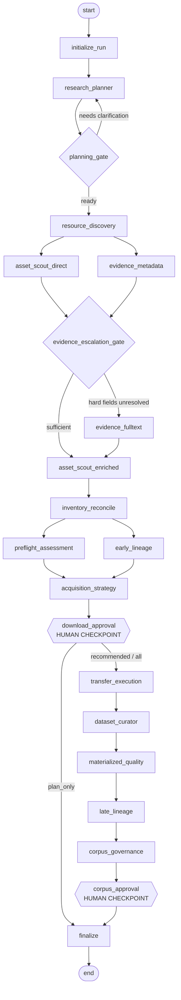

# scdata-agent

Evidence-first discovery and curation agent for **public single-cell epigenomics data**
(scATAC-seq / snATAC-seq and single-cell multiome).

`scdata-agent` automates the data-curation half of building a single-cell epigenomics
foundation model: it turns a natural-language research question into an executable
search contract, queries public repositories, reconciles the returned metadata against
observed remote file manifests, and produces an auditable acquisition plan — **stopping
at a human approval gate before a single byte is downloaded.**

> **Status: alpha / research prototype.** The pipeline runs end to end against live
> public APIs, but the bundle-completeness logic has known gaps that currently prevent
> it from auto-recommending datasets. See [Known limitations](#known-limitations).

---

## Design principles

These are enforced in code, not just documented:

- **No bytes before consent.** Transfer execution is unreachable until a persisted
  human checkpoint is resolved. A second checkpoint gates publication of the immutable
  corpus snapshot.
- **Evidence has provenance classes.** Claims are labelled by how they were obtained.
  `FILE_OBSERVED` and `RECOMPUTED` evidence requires local bytes and therefore cannot
  be produced before transfer — the agent cannot "conclude" something it never saw.
- **No access circumvention.** Only open full text is fetched. Paywall or
  authentication bypass is out of scope; controlled-access sources stay metadata-only.
- **Deterministic gates, ranked advice.** Hard gates (access, modality, licence) are
  plain code. The LLM proposes and summarises; it never silently decides admission.
- **Append-only catalogue.** Runs, artifacts, claims, bundle states and snapshots are
  written to a local SQLite ledger for cross-run auditing.

## Architecture

A LangGraph state machine (`application/orchestration_v2.py`) drives ten specialist
agents. Discovery forks into a fast direct asset scout and a non-blocking metadata
review; the two rejoin at an escalation gate that decides whether open full text is
needed to resolve remaining hard fields.



Package layout follows a strict dependency direction, asserted by
`tests/test_architecture.py`:

| Layer | Path | May depend on |
|---|---|---|
| `domain` | pure models, gates, role inference | nothing internal |
| `application` | agents + LangGraph orchestration | `domain` |
| `infrastructure` | HTTP sources, LLM routing, persistence | `domain` |
| `interfaces` | Typer CLI, FastAPI control room | all of the above |

## Quick start

```bash
# 1. Environment
mamba env create -f environment.yml
mamba activate scdata-agent
python -m pip install -e '.[dev]'

# 2. Credentials (never commit .env — it is gitignored)
cp .env.example .env
$EDITOR .env                       # set STEPFUN_API_KEY (or another provider)
scdata-agent llm-check             # validates config, sends no billable request

# 3. Understand a question without touching the network
scdata-agent compile 'scATAC-seq and multiome data for representation learning' --no-llm

# 4. Live discovery across Europe PMC + GEO + SRA
export NCBI_EMAIL='you@example.org'   # NCBI asks for this on sustained use
scdata-agent discover 'human lung scATAC-seq and multiome' \
  --max-results 10 \
  --database var/scdata_agent.sqlite

# 5. Full pipeline; stops at the download checkpoint
scdata-agent agent-run 'scATAC and multiome data for representation learning' \
  --database var/scdata_agent.sqlite \
  --data-root data \
  --approved-license cc-by-4.0 \
  --remote-probe
```

The run halts with `status = waiting_for_decision` and an open checkpoint. Resolve it
explicitly — `plan_only` keeps plans and downloads nothing:

```bash
scdata-agent resume CHECKPOINT_ID --option plan_only --database var/scdata_agent.sqlite
```

A local control room (FastAPI + HTMX, SSE event stream) is available via
`scdata-agent serve`. See [`docs/commands.md`](docs/commands.md) for the full command
reference.

## Data source coverage

| Source | Role | Status |
|---|---|---|
| Europe PMC | publications, preprints, open full text | supported |
| NCBI GEO | study records, supplementary file manifests | supported |
| NCBI SRA | raw sequencing studies | supported |
| ENA | FASTQ manifests, checksums, byte sizes | supported |
| Zenodo / Figshare | author-deposited processed data | supported |
| ENCODE | curated epigenomic reference data | **not implemented** |
| CELLxGENE | curated single-cell atlases | **not implemented** |
| Single Cell Portal, HCA, BioStudies/ArrayExpress | atlases and archives | **not implemented** |
| EGA / dbGaP | controlled access | metadata-only by design |

The unimplemented sources are reported honestly at runtime in
`QueryPlan.uncovered_sources` rather than silently ignored. Adding them is the
highest-value contribution right now — see [Roadmap](#roadmap).

## Known limitations

Measured on a real end-to-end run (17 candidates from Europe PMC + GEO + SRA,
12 semantic bundles, all remote manifests verified with live HTTP probes):

**Every bundle landed in `manual_review`; `recommended` was 0.** Two independent
defects compound to produce this, and both must be fixed before the acquisition tier
is trustworthy:

1. **Bundle completeness uses one flat role list.** `agents/inventory_reconcile.py`
   applies `requirement.required_data_roles` to *every* candidate regardless of its
   modality. When a question mentions both scATAC and multiome, the compiler unions
   their roles, so a pure scATAC dataset is wrongly required to ship an RNA matrix and
   barcode linkage. Fix requires per-modality bundle schemas with OR-semantics role
   groups, scored independently.
2. **File-role inference is too narrow.** `domain/assets.py::ROLE_PATTERNS` does not
   recognise `.h5`, `.tar`/`.zip` archives, the 10x MTX triplet, `.tbi.gz`, or
   `.h5ad.gz`, so most real GEO/ENA payloads fall through to `other`. Archives in
   particular need a dedicated role — their contents are not remotely inspectable and
   should surface as an explicit warning, not a silent completeness failure.

Additional known rough edges:

- **Licence status is almost always `unknown`.** GEO/SRA expose no structured licence
  field, and the agent refuses to guess. This is deliberate but needs an auditable
  policy/allowlist to be practical.
- **The planner's offline fallback is domain-skewed.** When the LLM strategy branch
  exceeds its latency budget, a hardcoded disease-mechanism template takes over and
  injects clinical-outcome and spatial-validation needs that are irrelevant to a
  methods-oriented project. Check `planner_diagnostics` for
  `planner:fast_strategy_failed` to detect this.

## Configuration

Model routing is provider-neutral; StepFun is the default.

| Variable | Purpose |
|---|---|
| `SCDATA_AGENT_MODEL_PROVIDER` | `stepfun` (default), `openai_compatible`, `openai`, `openrouter`, `ollama`, `anthropic` |
| `STEPFUN_API_KEY` / `STEPFUN_MODEL` | default provider credentials |
| `SCDATA_AGENT_MODEL_{PLANNER,DISCOVERY,REVIEW,CHAT}` | per-role model overrides |
| `SCDATA_AGENT_REASONING_EFFORT[_ROLE]` | per-role reasoning effort |
| `NCBI_EMAIL` / `NCBI_API_KEY` | NCBI E-utilities etiquette and rate limits |
| `SCDATA_AGENT_TRACE_MODE` | `local` (default, nothing leaves the machine) or `langsmith` |

**Tracing is local by default.** Setting `SCDATA_AGENT_TRACE_MODE=langsmith` together
with `LANGSMITH_TRACING=true` uploads run traces — including your research questions —
to LangSmith's cloud. Opt in deliberately.

See [`.env.example`](.env.example) for the complete list.

## Development

```bash
mamba run -n scdata-agent pytest              # 61 tests, fully offline
mamba run -n scdata-agent pytest tests/test_architecture.py   # layer boundaries
```

The suite uses `monkeypatch` and `httpx.MockTransport` throughout — no network access
and no API key is needed to run it, which keeps CI cheap and deterministic.

Optional AnnData/MuData inspection support: `pip install -e '.[dev,curation]'`.

## Roadmap

Ordered by value to a single-cell epigenomics foundation-model corpus:

1. Fix the two bundle-completeness defects above so acquisition can recommend.
2. Add ENCODE, CELLxGENE, Single Cell Portal, HCA and BioStudies/ArrayExpress adapters.
3. Make licence resolution auditable instead of uniformly `unknown`.
4. Preserve the semantic relation of every extracted accession
   (`primary_data_deposition` vs `reused_dataset` vs `supplementary_reference`).
5. Normalised donor/sample/cell entities with ontology IDs, so lineage can move beyond
   accession and checksum families.
6. Reference-backed TSS enrichment, doublet detection, and explicit RNA/ATAC barcode
   intersection in QC.
7. A corpus optimiser for diversity, rarity, redundancy caps and auditable sampling
   weights.

See [`docs/journal.md`](docs/journal.md) for the detailed internal roadmap.

## Licence

Apache-2.0. See [LICENSE](LICENSE).
