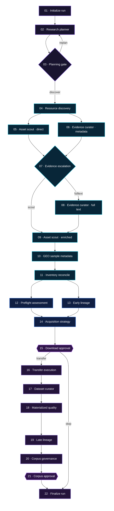

<p align="center">
  
</p>

<p align="center">
  
  
  
  
  
</p>

<p align="center">
  <strong>Turn a biological question into a traceable, approval-gated, analysis-ready single-cell dataset.</strong>
</p>

<p align="center">
  <a href="#-why-celllore">Why CellLore</a> ·
  <a href="#-workflow">Workflow</a> ·
  <a href="#-quick-start">Quick start</a> ·
  <a href="#-curation-outputs">Outputs</a> ·
  <a href="docs/commands.md">CLI reference</a> ·
  <a href="docs/roadmap.md">Roadmap</a>
</p>

---

## 🧬 Why CellLore

**CellLore** is an evidence-first discovery and curation agent for public single-cell
epigenomics data: scATAC-seq, snATAC-seq, RNA + ATAC multiome, and matched multimodal
studies.

It does more than search. CellLore turns a natural-language request into an executable
research contract, discovers candidate studies, reconstructs sample and pair-unit
relationships, reconciles remote files, checks download readiness, and materializes a
human-readable production dataset — with a persisted approval gate before transfer.

> [!IMPORTANT]
> **CellLore is the product and repository brand.** The Python distribution,
> Conda environment, and CLI are named `celllore`. The internal Python import
> namespace and existing `SCDATA_AGENT_*` configuration keys remain stable for
> compatibility with persisted runs and local deployments.

| | Capability | What CellLore records |
|---|---|---|
| 🔭 | **Evidence-aware discovery** | Study accessions, source URLs, publication year, assay and organism evidence |
| 🧩 | **Pair-unit reconstruction** | Human-readable units such as `Patient3_GSM9196533__GSM9196532` |
| 📦 | **File-level inventory** | Exact URLs, roles, byte sizes, checksums, availability and manifest status |
| 🛡️ | **Human approval gates** | No transfer before consent; no corpus publication before governance approval |
| 🧪 | **Post-transfer validation** | Compression, HDF5, semantic-role, barcode and materialized-object checks |
| 🗂️ | **Analysis-ready layout** | Stable metadata, RNA, ATAC, pairing, QC and audit directories |
| 🧾 | **Auditable provenance** | Append-only runs, artifacts, evidence classes, decisions and snapshots in SQLite |
| 🖥️ | **Live control room** | React/Vite UI, SSE updates, workflow map, stage timing and downloadable XLSX catalog |

> [!NOTE]
> CellLore is an **alpha research prototype**. The workflow runs end to end against
> live public APIs, but uncertain evidence is deliberately routed to audit or human
> review rather than guessed.

## 🧭 Workflow

The control room renders the supervisor's canonical **22-node LangGraph DAG**.
This compact view matches the live `PROCESS MAP`: planning feeds a branched
discovery path, inventory fans out into parallel QC checks, and the lower two rows
form an approval-gated curation loop back to finalization.



### Human checkpoints

1. **Download approval** — choose plan-only, recommended bundles, or a bounded subset.
   Transfer is unreachable before this persisted decision is resolved.
2. **Corpus approval** — approve or retain the immutable corpus snapshot as a draft
   after materialized QC and lineage checks.

## ⚡ Quick start

### 1. Install

```bash
mamba env create -f environment.yml
mamba activate celllore
python -m pip install -e '.[dev]'
```

### 2. Configure a model provider

```bash
cp .env.example .env
$EDITOR .env                      # add the API key for your chosen provider
celllore llm-check                # validates configuration without a billable call
```

### 3. Compile a research question offline

```bash
celllore compile \
  'public human PBMC data with same-cell scRNA-seq and scATAC-seq' \
  --no-llm
```

### 4. Run the approval-gated pipeline

```bash
export NCBI_EMAIL='you@example.org'

celllore agent-run \
  'find 2 public human PBMC datasets with RNA and ATAC from the same cell or nucleus' \
  --database var/celllore.sqlite \
  --data-root data \
  --remote-probe
```

The first half of the run stops at `waiting_for_decision`. Resume it explicitly:

```bash
celllore resume CHECKPOINT_ID \
  --option recommended \
  --database var/celllore.sqlite
```

Use `--option plan_only` to retain plans without downloading any bytes.

### 5. Open the control room

```bash
celllore serve --database var/celllore.sqlite --port 8000
```

Open `http://127.0.0.1:8000`. On a remote machine, forward the same port through your
editor or SSH:

```bash
ssh -L 8000:127.0.0.1:8000 user@remote-host
```

See [the full CLI reference](docs/commands.md) for planner modes, licence policy,
remote probes, result limits and checkpoint options.

## 📚 Curation outputs

### Candidate dataset catalog

Every run exposes four searchable UI sheets and a matching XLSX download:

| Sheet | Purpose |
|---|---|
| `01_Studies` | Study evidence, public year, catalog status and next action |
| `02_Pair units` | Traceable same-cell or same-nucleus RNA–ATAC logical units |
| `03_Files` | Exact file, URL, role, size, manifest and post-download checks |
| `04_Audit / hold` | Blocking reason, audit procedure, pass criteria and release condition |

Internal IDs remain in the ledger for stable joins, while curator-facing tables and
directories use readable identities whenever the evidence supports them.

### Production directory

Materialized bundles follow a consistent, inspection-friendly layout:

```text
data/production/YYYY-MM-DD_RUN_<run_id>/
└── GSE158013/
    └── Multiome_nuclei_W1_GSM5123949/
        ├── 01_metadata/
        ├── 02_rna_raw_counts/
        ├── 03_atac_fragments/
        ├── 04_standardized/
        │   ├── rna/
        │   │   ├── rna_raw_counts.h5ad
        │   │   └── rna_file_manifest.json
        │   ├── atac/
        │   │   ├── fragments.tsv.gz
        │   │   ├── fragments.tsv.gz.tbi
        │   │   └── atac_file_manifest.json
        │   ├── metadata/
        │   │   ├── barcode_metadata.tsv.gz
        │   │   ├── sample_metadata.json
        │   │   └── metadata_sources.json
        │   ├── pairing/
        │   │   ├── barcode_mapping.tsv.gz
        │   │   └── pairing_report.json
        │   ├── qc/
        │   │   ├── process.jsonl
        │   │   ├── validation_report.json
        │   │   ├── validation_summary.tsv.gz
        │   │   └── warnings.log
        │   └── status.json
        ├── 05_auxiliary/
        └── 99_raw_optional/
```

## 🔎 Data source coverage

| Source | Role | Coverage |
|---|---|---|
| NCBI GEO | Study metadata, samples and supplementary manifests | **Supported** |
| NCBI SRA | Raw sequencing studies | **Supported** |
| ENA | FASTQ manifests, checksums and byte sizes | **Supported** |
| Europe PMC | Publications, preprints and open full text | **Supported** |
| Zenodo / Figshare | Author-deposited processed data | **Supported** |
| EGA / dbGaP | Controlled-access discovery | Metadata-only by design |
| ENCODE / CELLxGENE / HCA / SCP | Curated atlases and references | Planned |

Unsupported sources are recorded in `QueryPlan.uncovered_sources`; they are never
silently treated as searched.

## 🛡️ Evidence and safety model

CellLore is built around a few enforceable invariants:

- **No bytes before consent.** Transfer execution is gated by a persisted human
  decision.
- **No access circumvention.** Paywall and authentication bypass are out of scope;
  controlled-access studies remain metadata-only.
- **Evidence has provenance classes.** `FILE_OBSERVED` and `RECOMPUTED` claims require
  local bytes and cannot be produced before transfer.
- **Deterministic gates, ranked advice.** Access, modality, pairing and licence gates
  are code; models propose and summarize but do not silently admit data.
- **Append-only audit trail.** Runs, artifacts, decisions, bundle states and corpus
  snapshots are persisted in SQLite.

<details>
<summary><strong>Bundle completeness schemas</strong></summary>

Candidates are evaluated against valid bundle shapes, not against the union of every
modality mentioned in a question.

| Schema | Applies to | Required shape |
|---|---|---|
| `scatac_standalone` | scATAC / snATAC | accessibility signal + cell axis |
| `multiome_same_cell` | 10x Multiome, SNARE-seq, SHARE-seq | accessibility + RNA + per-cell linkage |
| `multiome_trimodal` | TEA-seq / DOGMA-seq | multiome shape + protein matrix |
| `matched_scrna_scatac` | matched but separate assays | accessibility + RNA + matched sample identity |
| `atac_protein` | ASAP-seq / ISSAAC-seq | accessibility + protein + cell axis |
| `raw_reads` | any assay | FASTQ; valid but expensive input |

`matched_scrna_scatac` is intentionally weaker than `multiome_same_cell`: sharing a
sample must never be reported as sharing a cell.

</details>

<details>
<summary><strong>Licence resolution</strong></summary>

| Status | Meaning |
|---|---|
| `restricted` | A declared licence matched the restricted list; always blocks |
| `approved` | A declared licence is allowlisted or explicitly approved |
| `repository_policy` | No record licence exists and all files are covered by recognized archive terms |
| `unknown` | Licence evidence is missing, incomplete or not allowlisted |

`repository_policy` fills only a genuine missing-field gap and never overrides a
licence that was actually observed. Use `--strict-license` to require a declared,
allowlisted licence.

</details>

<details>
<summary><strong>Pairing verification</strong></summary>

Pairing phrases such as *same-cell*, *same-nucleus*, *joint profiling*, `10x Multiome`,
`配对` and `同细胞` compile into a minimum pairing tier:

```text
same-cell ≡ same-nucleus
    > same-sample ≡ same-donor
    > study-level ≡ unverified
```

A shortfall is routed to audit with `pairing:unverified` rather than silently excluded,
because many valid multiome studies do not state “same cell” in their abstract.

</details>

## 🏗️ Architecture

The package follows a strict dependency direction enforced by
`tests/test_architecture.py`:

| Layer | Path | Responsibility |
|---|---|---|
| Domain | `src/scdata_agent/domain` | Typed models, gates, requirements and evidence rules |
| Application | `src/scdata_agent/application` | Agents, handoffs, curation catalog and LangGraph supervisor |
| Infrastructure | `src/scdata_agent/infrastructure` | Public APIs, LLM routing, persistence, transfer and QC |
| Interfaces | `src/scdata_agent/interfaces` | Typer CLI and FastAPI control surface |
| Frontend | `frontend` | React/Vite control room and catalog workspace |

Model routing is provider-neutral. StepFun is enabled in the example by default;
DeepSeek, OpenAI-compatible, OpenRouter, Ollama and Anthropic routes remain available.

| Variable | Purpose |
|---|---|
| `SCDATA_AGENT_MODEL_PROVIDER` | Default model provider |
| `DEEPSEEK_API_KEY` / `DEEPSEEK_MODEL` / `DEEPSEEK_BASE_URL` | DeepSeek credentials, V4 model ID and endpoint |
| `SCDATA_AGENT_MODEL_{PLANNER,DISCOVERY,REVIEW,CHAT}` | Per-role model overrides |
| `SCDATA_AGENT_REASONING_EFFORT[_ROLE]` | Per-role reasoning effort |
| `SCDATA_AGENT_PLANNER_MODE` | `deep` or `fast` planner mode |
| `SCDATA_AGENT_PLANNER_TIMEOUT_SECONDS` | Overall planner time budget |
| `SCDATA_AGENT_TRACE_MODE` | `local` by default or explicit `langsmith` opt-in |
| `NCBI_EMAIL` / `NCBI_API_KEY` | NCBI E-utilities etiquette and rate limit |

See [`.env.example`](.env.example) for the complete list.

## 🧪 Development

```bash
mamba run -n celllore pytest
mamba run -n celllore ruff check src tests
cd frontend && npm ci && npm run build
```

The test suite is offline by default and uses mocked HTTP transports; no API key is
required. Optional AnnData/MuData inspection support is available through:

```bash
pip install -e '.[dev,curation]'
```

## ⚠️ Known limitations

- Archive contents such as `GSExxxxx_RAW.tar` cannot be classified before transfer;
  they are marked `archive:uninspected` and routed to review.
- Public archives often provide repository terms rather than a per-record licence;
  CellLore preserves that weaker evidence class instead of calling it an approved
  licence.
- `--max-assets` bounds very large manifests. Truncated inventories are flagged and
  cannot be treated as complete.
- File-role inference recognizes common 10x and archive conventions but intentionally
  leaves unfamiliar names unclassified instead of guessing.
- Several high-value atlas sources remain planned rather than implemented.

See the active [roadmap](docs/roadmap.md), its [Chinese version](docs/roadmap.zh-CN.md),
and the [architecture journal](docs/journal.md).

## 🤝 Contributing

Contributions that improve source coverage, evidence resolution, pair-unit parsing,
post-transfer QC or curator experience are welcome. Start with
[CONTRIBUTING.md](CONTRIBUTING.md) and keep hard scientific gates deterministic and
test-backed.

## 📄 License

Apache-2.0. See [LICENSE](LICENSE).
